# PERSONAL LEARNING GUIDE — Cantill.ai Spend Intelligence Engine

> **PRIVATE STUDY MATERIAL — NOT an official assessment deliverable.** It explains this exact implementation so the
> author can defend every decision in an interview. It contains no raw company records; figures are aggregate
> measurements produced by this repository (see `reports/`). Where a number is quoted, the run that produced it is named.
> Anything not implemented is labelled *future work*.

---------------------------------------------------------------------------------------------------------------------

---------------------------------------------------------------------------------------------------------------------

## Chapter 1 — The business problem

**Procurement** is how a company buys what it needs from third-party suppliers: materials, spare parts, services.
**Spend analytics** answers "how much do we spend, on what, with whom?". The deliverable is a **spend cube**: one row per
purchase line with (supplier, item, category, amount, date…). Procurement heads slice it by category to find savings
(consolidate suppliers, renegotiate, stop maverick buying).

Why is getting the cube hard?

| Problem | Where it shows up in the kit | What breaks if ignored |
|---|---|---|
| Spend sits in several systems | A: SAP goods receipts **and** an AP invoice tool; B: eight ERPs (JDE + SAP) | double counting (a purchase appears in both A systems) |
| Different currencies / tax / formats | A tool is gross of VAT; B has 25 currencies; dates in 3 formats | totals wrong by 15 %, or by factors of 1000 (MMK, PYG, CLP) |
| Same supplier/item typed many ways | `ZORVEX  TECHNOLOGIES (PTY) LTD` vs `ZORVEX TECHNOLOGIES PTY LTD`; OCR `B0OM` | spend per supplier looks fragmented → no negotiating leverage |
| Not all money movements are "spend" | cancelled invoices, taxes, intercompany, royalties | the cube overstates third-party spend |
| Descriptions are poor | `ROD DRIL;SIZE 35 MM`, blank, `Product`, Russian text | classification is hard |
| Every client has its own tree | A: 5/24/40 categories; B: 9/25/40; C: up to 4 levels, unknown | a model with hard-coded categories is useless on a new client |

**Why duplicate spending is dangerous.** If the same invoice appears in the ERP and the invoice tool and both are counted,
reported spend is inflated (here ≈ 1.5× for the matched part). Decisions (e.g., "this supplier is our #1 at R 400 m") are
then made on fiction. Conversely, over-aggressive de-duplication *loses* real spend — so every merge is evidence-based.

**Business value of the engine:** one command turns raw extracts of any company into an auditable spend cube, with a
reason for every excluded row and a confidence for every classification, so analysts only review the uncertain tail.

---------------------------------------------------------------------------------------------------------------------

## Chapter 2 — The datasets (what each file is, how it is used, what we found)

### Company A — mining operations of a chemicals group, ZAR, 2021–2024
| File | Meaning | Key columns (actual names) | Used for | Problems found |
|---|---|---|---|---|
| `erp_goods_receipts.csv` | 37,029 SAP goods-receipt lines (what physically arrived) | `line_id`, `po_number`, `po_item`, `material_number`, `material_short_text`, `service_short_text`, `quantity`, `value_zar`, `supplier_name`, `vendor_id`, `spend_type`, `material_type` | the **primary** system: every line is real spend (net of tax) | 66 % of rows lack `vendor_id`, date, UoM; 434 negative lines (reversals); supplier names typed with double spaces |
| `invoice_tool_export.csv` | 28,520 AP-tool invoice lines (what suppliers billed) | `tool_record_id`, `invoice_number`, `supplier_name_as_captured`, `po_reference`, `line_text` (OCR'd), `gross_amount`, `vat_rate`, `status` | the **secondary** system: ~55 % duplicate ERP lines, the rest is tool-only spend | VAT typed `15`, `0.15`, `15%`, blank, `0`; PO typed 4 ways or missing; 3 date formats; re-exports with new invoice numbers; OCR noise |
| `labels_A.csv` | golden L1–L3, `supplier_key`, `item_key` for every ERP line | | training + **evaluation** of matching, supplier/item grouping and classification | the golden supplier key puts 122 small names (56 % of rows) into one bucket; one golden item bucket holds 192 codes |
| `taxonomy_A.csv` | the tree: 5 L1 / 24 L2 / 40 L3 | `category_l1..3` | the classification target, read at run time | some leaves repeat the L2 name in L3 (the branch ends at L2) |

### Company B — metal-packaging manufacturer, USD, 2024
| File | Meaning | Key columns | Notes |
|---|---|---|---|
| `invoice_lines.csv` | 41,028 AP lines from 8 ERPs (5 JDE, 3 SAP) | `line_id`, `source_system`, `vendor_id`, `line_description`, `line_amount`, `currency`, `currency_rate`, `posting_date`, `invoice_date`, `gl_account_description`, `supplier_type`, `document_type` | no supplier names; 17 % blank descriptions; placeholder material number on 25 % of lines; 613 exact re-exports; 42 broken invoice dates |
| `fx_rates_usd.csv` | monthly rates, units of currency per 1 USD, 30 currencies | `currency`, `month`, `units_per_usd` | months are not continuous; used when a line has no `currency_rate` |
| `seed_labels.csv` | 3,000 analyst-labelled lines ("useful, not perfect") | `include`, `exclusion_reason`, `category_l1..3` | 450 are `NON_PROCUREMENT`; used to train *and* to validate exclusion rules |
| `taxonomy_B.csv` | 9 / 25 / 40 tree | | |

`output_template.csv` shows the required output format. **Never commit any of these files** (public repo) — `.gitignore` blocks `*.csv`
except the two output files.

---------------------------------------------------------------------------------------------------------------------

## Chapter 3 — System architecture

```mermaid
flowchart LR
  CFG[company YAML + common.yaml] --> L[config_loader: validate]
  L --> I[ingestion: read CSV as text, map columns]
  I --> N[normalise: dates, amounts, VAT, FX]
  N --> X[exclusion_engine: status, non-procurement, in-source duplicates]
  X --> M[transaction_matcher: cross-system duplicates]
  M --> S[supplier_resolver]
  S --> It[item_resolver]
  It --> C[hybrid_classifier: prior + self-training / supervised]
  C --> O[output_generator + validator]
```

### Folders and files
| Path | Role |
|---|---|
| `main.py` | the one command; parses CLI flags, calls `run_company`, prints a summary |
| `configs/common.yaml` | defaults shared by all companies: status vocabulary, generic non-procurement regexes, precedence of exclusion codes |
| `configs/company_a.yaml`, `company_b.yaml`, `company_c_template.yaml` | per-company description (files, joins, columns, formats, rules) |
| `src/config/config_loader.py` | loads YAML/JSON, resolves `extends`, **validates** required keys; raises `ConfigError` with readable messages |
| `src/ingestion/data_loader.py` | reads every CSV as **text** (no silent type coercion), maps configured columns to *logical* names (`description`, `amount`, `po`…) and builds `record_id` |
| `src/ingestion/schema_validator.py` | checks every configured column exists in the file and that record ids are unique |
| `src/preprocessing/amount_normalizer.py` | exact `Decimal` parsing of money and tax rates |
| `src/preprocessing/date_normalizer.py` | multi-format date parsing with flags (OK/MISSING/UNPARSEABLE/OUT_OF_RANGE) |
| `src/preprocessing/text_normalizer.py` | casefolding, accent stripping, supplier legal-suffix removal, PO and invoice-number normalisation |
| `src/spend/financials.py` + `currency_converter.py` | VAT removal, FX conversion with a fallback chain and flags |
| `src/spend/exclusion_engine.py` | status mapping, non-procurement rules, in-source duplicates, precedence |
| `src/matching/transaction_matcher.py` | cross-system matching (Chapter 6) |
| `src/matching/similarity_engine.py` | RapidFuzz-based similarity primitives that return `None` for missing evidence |
| `src/matching/supplier_resolver.py`, `item_resolver.py` | entity resolution (Chapters 7–8) |
| `src/taxonomy/taxonomy_loader.py` | `Taxonomy` dataclass: leaf paths, prefixes, validation |
| `src/classification/*` | `semantic_classifier.py` (embedding wrapper + disk cache), `text_classifier.py` (TF-IDF + logistic regression), `zero_label_classifier.py` (prior, self-training, smoothing), `hybrid_classifier.py` (orchestrator, hierarchical decode, confidence) |
| `src/evaluation/*` | metrics, golden-key comparison, output validator, confidence-fit script |
| `src/output/output_generator.py` | the 11-column file |
| `src/pipeline.py` | orchestration + timing + diagnostics JSON |
| `scripts/zero_label_experiments.py` | reproducible experiment harness (identical rows for every variant; writes `reports/private/experiments_*.csv`) |
| `scripts/final_validation.py` | independent re-computation of VAT/FX/exclusion rules from the raw files, compared with the output files |
| `scripts/entity_resolution_report.py` | supplier/item grouping scores vs golden keys, with and without the catch-all bucket |
| `src/__init__.py` | imports torch *before* numpy/pandas (Windows DLL-order fix); guarded by a test |
| `tests/` | 81 unit / integration tests on synthetic data (78 original + 3 added in the optimisation pass) |

**Data flow in one paragraph.** `run_company` loads the config, reads each source, maps columns to the logical schema
(`standardise_source`), parses dates (`normalise_dates`) and money (`compute_spend`), concatenates all sources into one
DataFrame `txn` (one row per input record), applies exclusions, annotates cross-source matches, resolves suppliers and
items, classifies the *included* rows, then writes `build_output(txn)` after `validate_output` has passed.

---------------------------------------------------------------------------------------------------------------------

## Chapter 4 — Data-engineering fundamentals used here

* **Read everything as text** (`dtype=str, keep_default_na=False`): pandas would otherwise turn `00123` into `123`, `NA` into NaN,
  and `0` into a number we can no longer tell from blank. We convert explicitly and *flag* what fails.
* **Missing values**: blank ≠ zero. VAT blank → 15 % (rule), VAT `0` → 0 % (a real value). Missing dates stay NaT with a flag.
* **Schema validation**: `validate_source_frame` lists the missing columns *and* the available columns — a typo in a new
  company's YAML is diagnosed in one line instead of failing deep inside pandas.
* **Record conservation**: every input row becomes exactly one output row. `validate_output` checks no id is missing, extra or
  duplicated. Rows are never dropped for bad dates/amounts; they are flagged and reported.
* **Lineage**: `record_id` (e.g. `ERP:A000002`, `TOOL:TA020125`), `match_to` (which ERP line a tool line duplicates),
  `np_rule` (which regex made a line non-procurement), `fin_flag` / `tax_flag` / `*_flag` (how a number was derived). They are in
  the working DataFrame and summarised (aggregate counts only) in `reports/run_*.json`.
* **Data quality ≠ data cleaning**: the pipeline *measures* quality (flags, diagnostics) before deciding anything.

---------------------------------------------------------------------------------------------------------------------

## Chapter 5 — Financial calculations

### Gross vs net, VAT removal
A tool amount is *gross*: `gross = net × (1 + r)`. So
`net = gross / (1 + r)` — **not** `gross × (1 − r)`. Example from the tests: gross 8,721.47 at 15 % →
8,721.47 / 1.15 = 7,583.89 (rounded half-up once, at the end). ERP values are already net and are **never** touched
(`amount.basis: net` in the config); this is how double tax removal is prevented structurally.
`parse_rate_fraction` accepts `15`, `0.15`, `15%`, `15.0`; values ≥ 1 are percentages; blank/invalid → the configured default
(0.15) and flagged `DEFAULTED`/`INVALID`; an explicit `0` is kept as 0 % — the data proved it: the 1,580 lines with `0`
equal their ERP counterparts at gross = net.

### Exchange rates
The brief: `currency_rate` = units of line currency per **1 USD**, so `USD = local / rate`. Example: 100 EUR at rate 0.5 EUR/USD
= 200 USD (`test_fx_conversion_units_per_usd`). USD lines stay unchanged even if they carry a rate. If the line has no rate we use
`fx_rates_usd.csv` for the **invoice month**; if the invoice date is broken we use the posting month; if the exact month is
missing we use the *nearest* month of the same currency and flag `FX_NEAREST_MONTH`; if the currency is absent we do **not** invent a
rate (`FX_MISSING`, spend stays unconverted and is reported).

### Decimal precision
Binary floats cannot represent 0.1 exactly; summing 40,000 floats accumulates error. `parse_amount` returns `Decimal`; VAT and FX
divisions use `Decimal`; the result is quantised to cents with `ROUND_HALF_UP` **once**. Only afterwards is it stored as float64 for
vectorised work (the cents rounding has already been applied, so the float is the nearest representable cent value).

### Negative amounts and reconciliation
Negative lines (credit memos, reversals) are *kept*: a reversal pair nets to zero in the cube. Excluding them would overstate spend.
Reconciliation is automatic: included spend = Σ spend of included rows; excluded rows have spend 0 by construction.

---------------------------------------------------------------------------------------------------------------------

## Chapter 6 — Transaction matching (record linkage)

**Record linkage** = deciding that two records refer to the same real-world thing. Exact join keys fail here because the
tool's PO is typed `PO#4510000018`, `PO 4510000018`, `4510000018/10.0` or missing, and re-exports even carry a new invoice number.

### The algorithm (`transaction_matcher.match_transactions`)
1. **Normalise**: PO core by regex (`(\d{8,12})`, ignoring `PO#`, spaces and the `/10.0` line suffix); supplier name compacted
   (legal suffixes removed, no spaces); description lowercased; quantity numeric; net amount from VAT removal.
2. **Candidate generation (blocking)**: the ERP net amounts are sorted; for each tool line only ERP lines whose amount is within
   `max(0.05, 0.02 %)` are candidates (binary search). Complexity ≈ O(n log n + candidates) instead of O(n × m) = 1 billion pairs.
3. **Eligibility gate**: *amount agrees* **and** (same PO, **or** supplier similarity ≥ 0.80 and (equal quantity or text similarity ≥ 0.55)).
   If the POs are both present and *different*, supplier **and** quantity **and** text must all agree. Hence: no match on text alone, none on amount alone.
4. **Score** (transparent weighted average of the available evidence; missing evidence is excluded, not counted as zero):
   amount 0.35, PO 0.25, supplier 0.15, quantity 0.10, text 0.10, date 0.05.
5. **One-to-one assignment**: edges are sorted by score; each ERP line is consumed once. Accept ≥ 0.70; 0.50–0.70 = `AMBIGUOUS`
   (kept and flagged — never forced).
6. **Aggregates**: a tool line with a PO but no single match may settle several free ERP lines of that PO: subset-sum over ≤ 14 lines,
   quantities must add up (4 cases in A).
7. **Left-over copies**: a further tool line that is identical (PO, amount, qty, supplier) to an ERP line already consumed → `DUP_OF_PRIMARY`.
8. **Re-exports among tool lines**: lines equal on amount, quantity, supplier, text and PO (or, without PO, invoice number or date within 7 days) → keep one (`EXPORT_DUPLICATE`).
9. **ERP precedence**: the ERP line is kept; matched tool lines become `DUPLICATE`.

### Why these choices
* *Invoice number is not required to be equal*: data showed identical purchases re-exported with totally different invoice numbers.
* *False positives (merging different purchases) cost real spend; false negatives (missing a duplicate) double count spend.* The gate
  prefers precision; the score is only used to order competing candidates and to flag weak matches.
* *Rejected alternatives*: pure fuzzy description matching (descriptions repeat for recurring deliveries), global TF-IDF nearest neighbour
  (O(n²) and text-only), Hungarian assignment (greedy is optimal when scores are nearly 1.0 and ties are rare; Hungarian adds scipy cost for no gain).
* Result on A (`reports/run_A_*.json`): see Chapter 14 for the measured counts.

---------------------------------------------------------------------------------------------------------------------

## Chapter 7 — Supplier entity resolution

**Entity resolution** = grouping records that describe the same real-world entity and giving the group one canonical identity.
`supplier_resolver.resolve_suppliers` uses union–find over evidence:
1. same vendor id (scope `global` or `per_system`, config);
2. the *same line* carrying both a name and a vendor id links them;
3. names that are identical after normalisation (`ZORVEX  TECHNOLOGIES (PTY) LTD` → `zorvextechnologies`; OCR digit look-alikes `BORL0NT` → `borlont`);
4. fuzzy similarity (RapidFuzz `ratio` ≥ 92 on compacted names of ≥ 7 characters, digit pattern must agree);
5. names on lines of the same PO and moderately similar (≥ 75) — a PO belongs to one supplier.
Blocking is not needed at A's size (≈ 200 unique names → one 200×200 `cdist`); above 4,000 names it blocks by the first two characters.

**Over-merging** (two real suppliers merged) silently wrecks spend per supplier; **under-merging** only fragments it. We therefore
chose a high threshold and print the *uncertain* pairs (85–92) for inspection; on A they are genuinely different vendors (e.g. two
names differing in one syllable). Measured on A against golden keys (non-bucket suppliers): purity 1.00, completeness 1.00.

**B** has no names: `supplier_key` = vendor id (global scope: 3,995 ids, 74 appear in several ERPs, numbered consecutively company-wide).
Different ids are never merged. The key is hashed (`SUP-xxxxxxxxxx`) so no company text is published.

---------------------------------------------------------------------------------------------------------------------

## Chapter 8 — Item entity resolution

Items differ from suppliers: a supplier name is short and mostly identity; an item description carries *specifications*. "BOLT 20MM" and
"BOLT 25MM" are 96 % similar as strings but different products. Hence:
1. a material **code** is authoritative (same code → same item; different codes never merge on text — in the golden data identical wording under
   different codes is split 83 % of the time);
2. a code is ignored when it is a **placeholder** (many mutually unrelated descriptions — B's `MAT-1000007`);
3. code-less lines group by near-identical text within the supplier **and identical numeric signature** (`37,5mm` ≠ `53mm`, `3,5M,8` ≠ `3,5M,6`);
4. OCR repair of letter-rich tokens (`RE5IN` → `resin`) before comparison;
5. a code-less group that matches a coded item of the same supplier joins it; otherwise it becomes its own item; no information → `unspecified item`.
Measured on A (non-bucket golden items): pairwise precision 1.00, recall 0.987.

---------------------------------------------------------------------------------------------------------------------

## Chapter 9 — The exclusion engine

| Code | Meaning | How decided (generic, configurable) |
|---|---|---|
| `CANCELLED` | cancelled invoice/line | status text in the configured cancelled list (`cancelled`, `void`, `annulled`…) |
| `NOT_APPROVED` | anything not approved/paid | *any other* non-blank status (rejected, on hold, submitted, disputed…); blank status = approved by default (`blank_status`) |
| `NON_PROCUREMENT` | real money, not third-party supply | regexes over account text (intercompany `IC06`, `I/C Payable`, `Intercompany`), tax postings in the description (`State & Local Taxes`, `GST Input Tax`), royalty/dividend/financing/partner-billing keywords; plus per-company rules (supplier-type codes) |
| `DUPLICATE` | already counted | in-source exact re-exports (`duplicate_key`), cross-system matches, re-exports |

**Precedence** (`exclusion.precedence`, default CANCELLED > NOT_APPROVED > NON_PROCUREMENT > DUPLICATE): a record's *own* state beats "counted elsewhere".
A cancelled invoice that also duplicates an ERP line is reported as `CANCELLED`; either way it adds nothing. Duplicates are only searched among
records that are otherwise live, so a duplicate of an excluded line is excluded for the line's own reason.

**Examples (real patterns, no records):** a B line whose account description is `IC Payables` → `NON_PROCUREMENT`; a B line "State & Local Taxes -" → tax posting; "Tax Services
and Garnishments" (consulting) → *included* (the regex requires the tax word right after the jurisdiction word and rejects `consult|service|work…`); an A tool line
with status `On Hold` → `NOT_APPROVED`.
Validation: the rules reproduce 450/450 analyst exclusions in B's seeds with 0 false positives among 2,550 included seeds — but note the rules were *designed while
looking at those seeds*, so this is a fit, not an out-of-sample test.

---------------------------------------------------------------------------------------------------------------------

## Chapter 10 — Taxonomy and hierarchical classification

A **taxonomy** is a category tree. L1 is the broadest level ("Direct Materials"), L2 narrower, L3 (and for C possibly L4) the most specific. Each row of the tree file is a *path*;
a **leaf** is the end of a path. We classify to the leaf and output the whole path so parents and children are always consistent.
`taxonomy_loader.load_taxonomy` reads the file at run time (columns from the config), refuses a deeper level filled under a blank
one, and exposes `paths`, `prefix_index(level)` (leaves under a prefix) and `padded(i)` (path padded with blanks to the configured depth).
**Hard-coding category names is dangerous** because a new company's tree has different names, depth and branching; a model that learned "Roof Bolts" cannot
classify a packaging company. Our code only ever sees category *strings from the file*.

---------------------------------------------------------------------------------------------------------------------

## Chapter 11 — Machine learning and NLP: the models actually used

| Component | File | Role |
|---|---|---|
| Sentence embeddings (4 models) | `semantic_classifier.py` | turn text into vectors; compare with taxonomy-path vectors |
| TF-IDF + linear model | `text_classifier.py` | learn word/character patterns from labels (supervised) or from pseudo-labels (self-training) |
| Hierarchical decoding | `hybrid_classifier.decode_hierarchical` | guarantees a valid path in the tree |
| Calibration / confidence | `hybrid_classifier.py`, `fit_confidence.py` | turn scores into a 0–1 confidence |

For each model: **what it does / how it works / why chosen / alternatives / pros / cons / where used.**

### TF-IDF
*What*: represents a text as a sparse vector of weighted word (1–2-gram) and character (3–5-gram, within word boundaries) counts.
*How*: `TF-IDF(t,d) = (1 + log tf) × log(N / df)`; rare, discriminative n-grams get higher weight; rows are L2-normalised.
*Why*: character n-grams make it robust to OCR noise (`RE5IN`), abbreviations (`CYLDR`) and any language; needs no download.
*Alternatives*: bag-of-words (brittle to typos), BM25, fastText. *Pros*: fast, interpretable. *Cons*: no semantics (`pallet` ≠ `skid`).
*Used*: input of the supervised model and of the self-training model.

### Logistic regression (multinomial) and SGD log-loss
*What*: linear classifier whose output `softmax(Wx + b)` is a probability over leaves. *Why LR for supervised*: strong, well-calibrated baseline on sparse text;
trained with L-BFGS, `C = 20`. *Why SGD for self-training*: the same objective optimised stochastically, one-vs-rest, ~30× faster
(LR needed ~90 s per round on 8k rows; the first full run stalled for over an hour), accuracy within 0.3 pt in the dev test.
*Alternatives*: LinearSVC (no probabilities), gradient boosting (slower, no gain on sparse text), fine-tuned transformer (no GPU). *Cons*: linear.

### Sentence-transformers (embeddings), cosine similarity, semantic search
*What*: a transformer maps a sentence to a dense vector (384/768 numbers) so that sentences with similar *meaning* are close.
*Cosine similarity*: `cos(u,v) = u·v / (|u||v|)`; vectors are L2-normalised so it is a dot product in [−1, 1].
*Semantic search*: compare the description vector with the vector of every taxonomy path ("Logistics > Freight > Road & Sea Freight").
*Which models*: `multilingual-e5-base` (best single model on B's multilingual descriptions: 43 % leaf accuracy zero-label vs 37 % for e5-small,
34 % MiniLM-L6, 31 % bge-small, 30 % paraphrase-multilingual-mpnet), plus `multilingual-e5-small`, `all-MiniLM-L6-v2`, `bge-small-en-v1.5` in a z-scored ensemble
(prior accuracy 46 % on B; ensembles of different encoders cancel individual errors). *Selection criteria* (not popularity): accuracy on the dev companies,
language support (B has Russian/Portuguese/Spanish text), size (base model ≈ 1.1 GB, others < 0.5 GB), CPU runtime (all unique texts are embedded once and cached on disk),
download requirement (one-off; the cache is reused). *Alternatives*: bigger models (e5-large, bge-m3: do not fit comfortably in the 7 GB dev machine),
LLM APIs (confidential data must not leave the machine — the brief forbids uploading it), local LLMs (not feasible on this CPU).
*Cons*: SAP-style abbreviations (`ROD DRIL`) are outside what a small encoder understands (Chapter 12).

### Supervised classification
When a labels file exists and is not hidden (`--zero-label`): 5-fold **GroupKFold** (groups = item + description, so identical lines never sit on both
sides), TF-IDF/LR and embedding/LR trained on the training folds predict the held-out fold. Every labelled line is therefore predicted by a model that has
**not** seen it; unlabelled lines use a model trained on all labels. The supervised probabilities are blended with the semantic prior with a weight chosen on out-of-fold log-loss.

### Zero-label and hybrid classification
See Chapter 12. "Hybrid" = prior + supervised (when labels exist) or prior + self-training (when they do not); the combination weight is *measured*, not assumed:
on A the supervised-only OOF accuracy was 92.7 % vs prior-only 20.5 %; the blend chose supervised weight 1.0.

---------------------------------------------------------------------------------------------------------------------

## Chapter 12 — Zero-label classification (final implementation)

**What it means.** The tool must classify spend lines into a category tree *without ever having seen labelled examples of that tree* ("zero-label"). The tree file (names only) is the only knowledge about the categories.
**Why the assignment requires it.** A new client arrives with a tree and unlabelled lines; Company C (50 % of the blind-test score) is exactly this. A system that needs labels or hard-codes categories cannot onboard it.

**Step by step (`hybrid_classifier.HybridClassifier.classify`, zero-label branch).**
1. *Text*: `pipeline.text_for_classification` cleans the description (keeps digits/specifications). If the description says nothing (no informative token) the configured `fallback_fields` (e.g. the GL account text) are appended. `pipeline.embedding_texts` optionally prefixes configured metadata (A: `spend type + material type : text`).
2. *Label texts* come only from the taxonomy (`zero_label_classifier.label_texts`): the full path `L1 > L2 > L3 (> L4)` and the last two levels. Every depth 1–4 works; blank levels end a branch.
3. *Embedding prior*: each of 4 encoders (e5-base, e5-small, MiniLM-L6, bge-small) embeds unique texts and label texts (cached on disk); similarity = 0.6·cos(text, path) + 0.4·cos(text, last-two); per model the similarity row is z-scored; the ensemble mean goes through a softmax (T = 0.5) → a probability distribution over **leaves** (an invalid parent/child pair cannot exist).
4. *Lexical prior*: char-n-gram TF-IDF cosine between the text and the path texts (`_lexical_scores`) — high precision on lines that literally share words with category names.
5. *Self-training per prior* (`zero_label_classifier.self_train`): on identical (description + context) rows collapsed and weighted, take the most confident 50 % of each predicted class (margin-ranked, class-balanced), train an SGD log-loss TF-IDF model on **description + supplier + context fields**, blend 70/30 with the prior; 3 rounds. The final distribution is the average of the two refined priors. This is where suppliers and accounts contribute without labels.
6. *Parent-only evidence sharing* (`share_parent_evidence`): lines of one supplier vote on the level-1 branch with their mean branch probability, `P' ∝ P · M_supplier[branch(leaf)]^s` (s = 1). The leaf *inside* the branch stays the line's own. Rows without supplier evidence form singleton groups.
7. *Top-down decode* (`decode_hierarchical`): choose the best L1 branch by summed leaf probability, then the best branch below it … down to a leaf → the output is always a valid path of the supplied tree.
8. *Blank descriptions*: fallback text → if still blank, most frequent predicted leaf with confidence ≤ 0.05.
9. *Company C*: nothing from A or B is used (no category string, no learned weights except the confidence coefficients). Context fields are whatever the C config maps.

**Evaluation without leakage.** `--zero-label` sets `y_train = None`; the label file is read only after prediction to score it (`labels_used_for_prediction: false` in the report). Duplicate/related lines are handled by group-aware folds in the supervised runs; zero-label inference has no training split at all.
**What the numbers are.** Design choices (priors, parent sharing, prefix) were made while looking at A's and B's hidden labels, so the zero-label figures below are **development performance**, not independent validation, and not blind-test performance.
**Final development numbers (labels hidden):** A leaf 24.0 % (baseline 17.8 %), L1 65.4 % (43.4 %), spend-weighted leaf 30.6 %; B leaf 65.8 % (62.2 %), L1 86.3 % (81.1 %), spend-weighted leaf 87.8 %, spend-weighted L1 97.9 %.
**Why A is still limited.** Error analysis: A's biggest categories (e.g. equipment-specific services and spares — thousands of lines each) use generic maintenance wording; the *equipment* appears neither in the text nor in the tree names. Only the supplier carries that information (98 % level-1 purity) and the supplier→leaf link is not recoverable without labels, so L1 improves a lot (parent-only sharing) while leaf accuracy stays low.
**Failure cases to know:** wrong prior propagated by self-training; suppliers that sell across branches (sharing then pushes lines to the dominant branch; mitigated by parent-only sharing); tree names that are not descriptive (A); blank text.

---------------------------------------------------------------------------------------------------------------------

## Chapter 13 — Optimization experiments

Full table with every number: `reports/optimization_experiments.md` (script `scripts/zero_label_experiments.py`). Protocol: identical rows, labels read after prediction, proxy ensemble (e5-small + MiniLM) for text variants that need re-embedding, full 4-model ensemble for final runs.

| Experiment | Problem / hypothesis | Approach | Result | Decision |
|---|---|---|---|---|
| Baseline reproduction | metrics must be recomputed, not trusted | rerun A/B zero-label and supervised | numbers matched the stored reports (A 17.8 %/43.4 %, B 62.2 %/81.1 %) | baseline accepted |
| Error analysis (A) | why 17.8 %? | per-category P/R/F1, confusion pairs, field purity | 13 of 37 leaves had F1 = 0; confusions cross L1 branches; supplier has 98 % L1 purity; account/cost-centre/site carry almost nothing | focus on supplier structure |
| E2 drop alphanumeric codes | codes confuse the encoder | strip long alphanumeric tokens before embedding | A −0.8 pt, B leaf 53→40 % | rejected |
| E3 head noun repeated | SAP text is `NOUN QUALIFIER;spec` | prepend the head phrase | A −2.3 pt, B −6 pt | rejected |
| E5 metadata prefix | `Service` vs `Material` changes meaning | prefix with spend/material type | A L1 45→53 % (with sharing 67 %) | retained for A (config) |
| E6 full-leaf evidence sharing | suppliers sell few categories | average log-probs over the supplier | A L1 +11 pt but B −16 pt leaf | rejected |
| E6d parent-only sharing | keep the leaf choice per line, share only the branch | supplier mean L1 marginals multiply P | A L1 +8–11 pt, B leaf 53→64 %, B L1 73→85 % | **retained** |
| E9 prior comparison | which prior should seed self-training? | lexical vs embedding vs mean (full B file) | lexical + ST 52.8 % leaf / 81 % spend-w; embedding + ST 41.8 %; averaging the two ST outputs 62 % | average of both retained |
| Encoder fine-tuning | train the encoder to match descriptions to path text on B, test on A | contrastive-style softmax over leaves | A 6.3 → 6.2 % | rejected |
| LR vs SGD in self-training | runtime | same objective | LR > 1 h; SGD same accuracy ± 0.3 pt | SGD retained |
| Abbreviation expansion | `DRIL`→`drill` | analysed; no dictionary is available offline and truncations are ambiguous (`EXPL`) | not implemented as unsafe | rejected |
| Larger multilingual model | e5-large / bge-m3 | not run: 7 GB RAM dev machine | n/a | not tried (stated) |
| Confidence recalibration | ECE 0.22 | refit on new features, leave-one-company-out | in-sample ECE 0.19, LOCO 0.37, AUC 0.65/0.78 | ranking signal only |

**Final effect:** A 17.8 → 24.0 % leaf, 43.4 → 65.4 % L1; B 62.2 → 65.8 % leaf, 81.1 → 86.3 % L1; supervised A 93.0 → 92.5 % (neutral/slightly lower, spend-weighted 89.2 → 89.8 %); supervised B unchanged.

---------------------------------------------------------------------------------------------------------------------

## Chapter 14 — Classification evaluation

* **Metrics** (`classification_metrics.py`): *accuracy* = share correct; *precision* = of lines predicted X, share truly X; *recall* = of lines truly X, share found;
  *F1* = harmonic mean; *macro F1* averages classes equally (rare classes matter), *weighted F1* by support; *level accuracy*: a line is L2-correct only if L1 *and* L2 agree;
  *confusion matrix* lists which categories are mistaken for which (private CSV in `reports/private/`, gitignored).
* **Entity metrics** (`matching_metrics.py`): pairwise precision/recall of a clustering vs golden keys, plus purity/completeness.
* **Measured results (this repository):** 

| Run | labelled lines | leaf acc | L1 | L2 | leaf acc spend-weighted | macro F1 | weighted F1 | acc. where conf ≥ 0.8 | ECE |
|---|---|---|---|---|---|---|---|---|---|
| A supervised (OOF) | 37,029 | 92.5 % | 98.4 % | 94.5 % | 89.8 % | 0.770 | 0.924 | 94.3 % | 0.001 |
| A zero-label | 37,029 | 24.0 % | 65.4 % | 30.7 % | 30.6 % | 0.198 | 0.189 | 66.5 % | 0.187 |
| B supervised (OOF) | 2,547 | 88.7 % | 93.1 % | 92.6 % | 96.6 % | 0.599 | 0.870 | 97.5 % | 0.006 |
| B zero-label | 2,547 | 65.8 % | 86.3 % | 84.5 % | 87.8 % | 0.525 | 0.679 | 100.0 % | 0.186 |

---------------------------------------------------------------------------------------------------------------------

## Chapter 15 — Confidence scoring

Signals: top probability `p1`, margin `p1 − p2`, **agreement** of the lexical-self-trained and embedding-self-trained argmax, text **informativeness**. Cosine similarity is never reported as a probability.
*Zero-label confidence* = `sigmoid(−3.649 + 4.889·p1 + 0.104·margin − 0.626·agree + 0.85·info)` (coefficients fitted by logistic regression on A+B hidden-label runs, companies weighted equally; `python -m src.evaluation.fit_confidence`).
*Supervised confidence*: same score then **isotonic regression** on out-of-fold correctness.
**Measured limitation.** Pooled in-sample ECE is 0.19 for both companies, but **leave-one-company-out ECE is 0.37–0.38**: A's accuracy is 24 %, B's 66 %, and nothing label-free tells the model which regime it is in, so the *absolute* calibration does not transfer. The *ranking* is useful: AUC of confidence vs correctness 0.65 (A) and 0.78 (B); reliability bins in `reports/confidence_fit.txt` (e.g. B: conf 0.73 → 97 % correct, conf 0.14 → 40 %).
Interpret zero-label confidence as "how much to trust relative to other lines", not as a percentage. Confidence is clipped to [0,1]; blank text ≤ 0.05; excluded rows carry confidence in the *exclusion decision*.
The confidence is **not** manipulated to improve spend-weighted metrics.

---------------------------------------------------------------------------------------------------------------------

## Chapter 16 — Performance engineering

Optimisations actually in the code: (1) every CSV is read once as text; (2) **blocking** — matching only compares amount-window candidates (binary search on sorted amounts);
(3) supplier similarity is one `rapidfuzz.process.cdist` per block, not Python loops; (4) only **unique texts** are embedded and results are cached on disk keyed by (model, text);
taxonomy label vectors are cached too; (5) self-training collapses identical (description+context) rows and weights them; (6) SGD instead of L-BFGS inside self-training;
(7) decimal arithmetic is confined to the 70k-row ingest loop (~30 s). Complexity: matching O(n log n + candidates), supplier cdist O(u²) for u unique names (blocked above 4,000),
item clustering O(u²) per supplier block with a 3,000-row chunk bound.
Runtime (this dev machine, 4 CPU cores, 7 GB RAM, no GPU): A: 65,549 records in 10.1 min; B: 41,028 records in 1.2 min; A zero-label: 65,549 records in 1.6 min; B zero-label: 41,028 records in 1.2 min. First run downloads/embeds; later runs reuse the cache.

---------------------------------------------------------------------------------------------------------------------

## Chapter 17 — Testing

81 tests (`python -m pytest tests -q`, ~5–70 s depending on whether models load): the 78 original tests are unchanged; 3 were added in the optimisation pass.
| File | What it validates |
|---|---|
| `test_financials.py` (38) | amount parsing (`1,234.56`, `1.234,56`, `(12.50)`, trailing minus), VAT fractions (`15`, `0.15`, `15%`, blank→default, explicit 0), net-from-gross exactness, FX conversion (units per USD, monthly fallback, nearest month flag, missing never invented), multi-format dates + flags, ambiguous date share, PO / invoice / supplier normalisation |
| `test_matching_and_exclusions.py` (17) | one-to-one matching, text-only / amount-only never match, aggregates, re-exports with different invoice numbers, recurring monthly charges not merged, status mapping, exclusion precedence, non-procurement rules, in-source re-exports, supplier merge/non-merge and vendor-id scope, item spec guard, OCR repair, item-code authority, taxonomy loading (variable depth, gaps), config errors |
| `test_integration_synthetic.py` (4) | whole pipeline on a two-system company and on a four-level one-file company defined only by YAML; categories exactly match the tree; readable error for a missing column; run report records the models actually used |
| `test_classification.py` (10) | valid-leaf decoding, softmax, zero-label never uses (poisoned) labels, blank → ≤ 0.05 confidence, supervised cross-fitting beats the prior, metrics by level, pairwise entity scores, **parent-evidence sharing**, **metadata prefix**, **torch imported before numpy (Windows model-loading guard)** |
| `test_output_contract.py` (12) | the validator rejects ten kinds of contract violation; blank excluded rows; rounding |
Additional non-pytest checks: `scripts/final_validation.py` recomputes VAT/FX/exclusion rules from the raw files with independent code and compares them with the output files (all PASS); `scripts/entity_resolution_report.py` reproduces the grouping scores.
Windows initialisation: `src/__init__.py` imports torch before numpy/pandas; the test `test_torch_is_imported_before_numpy...` fails loudly if the semantic models would silently fall back to lexical mode, and every run report lists `embedding_models_used`.

---------------------------------------------------------------------------------------------------------------------

**Final publication checks (re-executed).** Both pipelines re-run from scratch reproduce the output files byte for byte (the run is deterministic); `scripts/final_validation.py` still reports all PASS; 81 tests pass. `scripts/synthetic_company_c_check.py` fills `configs/company_c_template.yaml` for an *invented* four-level company (EUR/ZAR with a monthly FX table, a status column, an intercompany account, an exact re-export) and runs the unchanged CLI: all 8 contract checks pass. Be precise in an interview: this proves the *onboarding path*, not accuracy on the real Company C. Confidentiality hygiene: tests use invented supplier names (real ones that had slipped into early tests were replaced), raw data lives outside the repo, `.gitignore` blocks every CSV except the two outputs, and the repo has no commits yet — publishing is a manual step.

## Chapter 18 — Blind test

* **A2 / B2** (same layouts, new records): run the **frozen** configs with `--data-dir <new folder>`; because labels for the new records do not exist, point `--labels-dir` at the *kit* folder so
  the supervised models train on the original labels (A's ERP labels; B's 3,000 seeds). Command:
  `python main.py --config configs/company_a.yaml --data-dir <A2 folder> --labels-dir ../company_A --out submission/<aryan_sharma>__A2.csv`, same for B → `__B2.csv`.
* **C**: copy `configs/company_c_template.yaml` → `configs/company_c.yaml`, map the columns (the config *is* the only new artefact), run with no labels → automatic zero-label mode →
  `submission/<aryan_sharma>__C.csv`. A tree with 4 levels needs `level_columns` of length 4; blanks end a branch.
* Why C is different: no labels, an unseen tree, possibly different columns/currencies, a different industry (new vocabulary).
* **After 10:00 AM IST on 19 Nov nothing in `src/` or the A/B configs may change** (any code change after the deadline disqualifies the result); only the new C config and the three outputs are pushed into `submission/`.
  Do the dry run **before** the deadline with the template on a made-up file, check that the env (torch, models cached) works offline.

---------------------------------------------------------------------------------------------------------------------

## Chapter 19 — Engineering decision register

| Decision | Chosen | Alternatives | Why chosen | Trade-off | Actual result |
|---|---|---|---|---|---|
| Language/libs | Python, pandas, NumPy, scikit-learn, RapidFuzz, sentence-transformers | Spark, SQL, R | data fits in memory; best ML ecosystem | single machine | runs on a 4-core laptop |
| Read CSV as text | `dtype=str` | infer types | no silent loss (`0` vs blank, leading zeros) | explicit conversions | no type surprises; 0 vs blank preserved |
| Money | `Decimal` then cents once | float64 | exact cents, no drift | slower ingest (~30 s) | max abs diff vs independent recompute 0.0043 |
| Zero VAT | explicit `0` = 0 % | treat as blank | ERP match proves it | none | 1,580 zero-rated lines matched their ERP lines |
| Blank VAT | 15 % (brief) | skip line | rule | wrong for truly exempt lines | 6,542 lines use 15 % |
| FX rate | line rate → invoice month → posting month → nearest month → flag | invent / drop | traceable | nearest-month approximation flagged | 2,755/2,755 monthly-table lines agree with independent recompute |
| Matching gate | amount **and** (PO or supplier+qty/text) | text or amount alone | precision, coincidences are common | misses lines whose amount differs by > tolerance | 20,476 one-to-one matches, median score 1.000 |
| Assignment | greedy by score, one-to-one | Hungarian | scores near 1.0, ties rare | not globally optimal in theory | 0 ambiguous pairs |
| Re-export key | amount+qty+supplier+text+PO | invoice number | data shows invoice numbers differ | merges recurring identical charges only if PO equal | 713 re-exports + 571 copies found |
| Ambiguous pairs | keep + flag | force | do not invent matches | none occurred on A | none occurred |
| Exclusion order | CANCELLED > NOT_APPROVED > NON_PROCUREMENT > DUPLICATE | other | own state beats "counted elsewhere" | arbitrary for rare combos | A: 188 CANCELLED, 315 NOT_APPROVED, 21,764 DUPLICATE |
| Negative lines | keep | drop | net spend correct | negative spend rows | kept |
| Supplier merge | 92 % + exact compact + id + PO link | cluster at 80 % | over-merge is worse | some typos stay split | A purity/completeness 1.00/1.00 (no bucket) |
| Vendor-id scope (B) | global | per system | ids numbered company-wide | wrong if ids restart per ERP (configurable) | B: 3,995 vendors, none merged |
| Item identity | code authoritative; text within supplier with numeric guard | text first | golden data splits same wording under different codes | some code synonyms stay split | P 1.00 / R 0.987 (no bucket) |
| Keys in output | hashed | readable | no company text in a public repo | not human-readable | no company text in outputs |
| Embedding model | 4-model ensemble | one model, larger model, LLM | measured; offline; confidential data stays local | ~1.1 GB first download | 4-model ensemble; B prior 46 % leaf |
| Zero-label booster | self-training with context | none, fine-tune encoder | +7 pt leaf on B, no labels needed | cannot fix a wrong prior (A) | see Chapter 13 |
| Decoding | top-down hierarchical | argmax leaf | consistent path, better upper levels | may lose a few leaf hits | always a valid path |
| Confidence | sigmoid on 4 signals, transferred coefficients; isotonic when labels | raw similarity | calibrated | coefficients fitted on two companies | AUC 0.65/0.78; LOCO ECE 0.37 |
| LLM API | not used | Claude/Gemini | brief forbids uploading company data; no key needed; no cost | lower zero-label accuracy on jargon | none used |
| Repo data | `.gitignore` all CSV except two outputs | — | confidentiality | — | git dry-run stages only the 2 outputs |
| Parent-only supplier evidence sharing | supplier lines vote on the L1 branch, leaf stays per line | full-leaf sharing, no sharing | B -16 pt with full sharing; parent-only helps A and B | assumes supplier keys exist | A L1 +8-11 pt; B leaf 53 -> 64 % (proxy) |
| Dual-prior self-training | average of lexical-prior ST and embedding-prior ST | single prior | lexical prior has high-precision seeds, embeddings cover paraphrases | two self-trainings (~1 min) | B 62 % leaf vs 53 % / 42 % single |
| Metadata prefix on embedded text | configurable per company (`embed_prefix_fields`) | none, always | helps A (spend type), no effect on B | needs config | A L1 45 -> 53 % (proxy) |
| Rejected: encoder fine-tuning, code stripping, head phrase, abbreviation tables | - | - | measured no gain or unsafe | - | see Chapter 13 |
| Confidence as ranking signal | logistic on 4 label-free features | per-company calibration | cannot calibrate a company without labels | absolute values unreliable | LOCO ECE 0.37; AUC 0.65/0.78 |
| Independent validation script | separate code path recomputes money rules | trusting the pipeline | catches shared bugs | extra code | all PASS |

---------------------------------------------------------------------------------------------------------------------

## Chapter 20 — Interview preparation

1. **Why Python?** The task is data + NLP; pandas/scikit-learn/sentence-transformers/RapidFuzz are all Python; 40k–65k rows fit in memory so a distributed engine would only add complexity.
2. **Why pandas?** Tabular joins, vectorised string ops and the output contract are natural in it; hot loops that pandas can't vectorise (Decimal ingest, matching candidates) were isolated and measured (~30 s, ~50 s).
3. **How did you detect duplicate transactions?** Amount (±0.05) must agree, then PO or supplier+quantity/text; scored; greedy one-to-one against ERP lines; extra stages for aggregates and re-exports; ERP is kept.
4. **Why not match on description?** Recurring deliveries repeat the same text; coincidences of amount and text exist; the gate requires independent evidence.
5. **Why isn't the invoice number a key?** Re-exports of the same purchase carry different invoice numbers (observed), so equality would miss them; we use it only to break ties for no-PO pairs.
6. **How did you avoid false supplier matches?** High threshold (92), minimum length 7 for fuzzy, digit-pattern guard, uncertain pairs printed not merged; verified purity 1.00 on A's golden suppliers.
7. **How are vendor ids in B handled?** Treated as globally unique (consecutive company-wide numbering, 74 shared across ERPs) — a documented config switch; never merged across different ids.
8. **How did you handle missing currencies/rates?** Line rate, else monthly table for the invoice month, else posting month, else nearest table month (flagged), else unresolved & reported — never invented.
9. **Why embeddings?** Descriptions and category names share meaning, not words; embeddings give a prior without labels.
10. **How does cosine similarity work?** Dot product of L2-normalised vectors = cosine of the angle; 1 = same direction.
11. **How does zero-shot classification work here?** Compare the description vector with vectors of every taxonomy path, softmax over leaves, then refine with label-free self-training on the company's own text and context.
12. **How did you prevent leakage?** `--zero-label` never loads labels for prediction; supervised predictions are out-of-fold with GroupKFold; evaluation labels are read after predictions; different companies' labels are never mixed in evaluation.
13. **How did you measure accuracy?** Exact leaf, per-level prefix accuracy, macro/weighted F1, spend-weighted accuracy, ECE; table in Chapter 14.
14. **How does it generalise to an unseen company?** Everything company-specific is YAML; the tree is read from the file; category strings only come from that file; depth 1–4 supported.
15. **What if the taxonomy changes?** Re-run; label vectors and paths are recomputed; supervised models are trained on whatever labels map into the *new* tree (labels not found in the tree are ignored and counted).
16. **What would you improve with more time?** An LLM-assisted mode (with consent for data transfer), abbreviation expansion for SAP text, active-learning loop for the uncertain tail, per-category calibration.
17. **Why a 4-model ensemble?** Different encoders err differently; z-scored averaging lifted B prior accuracy from 43 % (best single) to 46 %.
18. **Why self-training?** The prior is right often enough to bootstrap a company-specific model; context (supplier, account) adds evidence the encoder never sees.
19. **Why top-down decoding?** The output must be a valid path; summing leaf probabilities by branch is the right marginal for upper levels.
20. **Why hashed keys?** The graders check grouping only; hashing avoids publishing supplier names/descriptions in a public repo.
21. **How are negative amounts treated?** Kept as negative spend (reversals net out).
22. **How is VAT removed and never double-removed?** `basis: gross` only for the tool source; ERP is `net` in config; tests cover it.
23. **What does `NOT_APPROVED` include?** Every status that is not approved/paid — rejected, on hold, submitted, disputed, unknown.
24. **How do you deal with ambiguous dates?** Formats are explicit per source; `auto` only accepts formats that parse the column; unparseable values are flagged, never guessed; no row is dropped.
25. **What is the time complexity of matching?** O(n log n) for sorting + O(candidates) scoring; candidates are the few ERP lines with the same amount.
26. **What is blocking?** Restricting comparisons to plausible candidates (same amount window, same prefix) so we avoid n×m comparisons.
27. **What is union–find and why here?** A structure for merging groups transitively; used for supplier and item clusters so merges are explainable and order-independent.
28. **Why RapidFuzz `ratio` and not token-set?** Supplier names are short; edit distance on compacted names captures spacing/typo variants without matching on shared common words.
29. **Why OCR repair?** Tool text contains `RE5IN`/`B0OM`; mapping digits to look-alike letters inside letter-rich tokens makes equal items compare equal.
30. **How is the 60-minute limit respected?** See Chapter 16; only unique texts are embedded; heavy stages are cached; measured runtime is far below the limit.
31. **What happens without network?** Cached embedding models load locally; if none can load the engine uses a lexical prior and states it in the report.
32. **What is your biggest risk on Company C?** Zero-label accuracy on an unseen tree; mitigation: ensemble + self-training + context, honest confidence so uncertain lines can be reviewed.
33. **Why is zero-label A accuracy low?** SAP short-texts are cryptic abbreviations; a small encoder cannot map `ROD DRIL` to "drill steel" from category names alone. Reported honestly.
34. **How did you verify exclusions in B?** Rules reproduce all 450 analyst exclusions with no false positives among 2,550 included seeds (fit, not out-of-sample).
35. **Why isotonic calibration?** It is monotone and non-parametric: it maps the raw score to the observed out-of-fold hit rate without assuming a shape.
36. **Why GroupKFold?** Many lines repeat the same item text; ordinary K-fold would put twins on both sides and inflate accuracy.
37. **What is the difference between supplier and item resolution?** Suppliers are identified by (short) names/ids; items by codes plus *specifications*; similar strings do not imply the same product.
38. **How would you add a fifth exclusion rule?** Add a regex rule to the company YAML (`non_procurement.rules`) — no code.
39. **How do you know every record is accounted for?** `validate_output` compares output ids with input ids and runs before the file is written; a failure aborts the run.
40. **What are the known limitations?** Chapter 20.
41. **What did you try that did not work?** Cross-company encoder fine-tuning (no transfer), LR inside self-training (too slow), merging items on text across codes (lowers precision), larger single models that do not fit memory.
42. **How is the spend total computed?** Σ over included rows of net, reporting-currency, cent-rounded values; excluded rows are 0 by construction.

43. **How did you check the baseline numbers were real?** I reran the stored runs and compared them with the reported metrics (they matched); then recomputed VAT/FX/exclusions with independent code (`scripts/final_validation.py`): max difference 0.0043 on A, all FX lines agree.
44. **What did error analysis show for A?** 13 of 37 leaves had F1 = 0; confusions cross level-1 branches; the biggest categories are equipment-specific services whose equipment is not in the text; supplier has 98 % level-1 purity, other metadata almost none.
45. **Why parent-only evidence sharing?** Sharing the whole distribution across a supplier cost B 16 points (suppliers sell several leaves); sharing only the branch marginal fixed the parent while each line keeps its own leaf: A L1 +8-11 pt, B +11 pt leaf.
46. **Why average two self-trained priors?** The lexical prior is precise where words overlap; the embedding prior captures paraphrases; either alone was worse on B (53 % / 42 % vs 62 % leaf).
47. **Is 65.8 % on B an estimate of Company C?** No. Design choices were made on A and B; it is development performance. Independent validation does not exist for C; the docs say so.
48. **Why is zero-label confidence not a probability?** Absolute calibration did not transfer across companies (leave-one-company-out ECE 0.37); only its ranking is useful (AUC 0.65/0.78).
49. **What did not work?** Encoder fine-tuning across companies, code stripping, head-phrase repetition, full-leaf supplier sharing, LR in self-training, merging items on text across codes.
50. **How do you make sure embeddings are really used?** `src/__init__.py` imports torch first; a test guards it; every run report lists `embedding_models_used`. Earlier runs silently used only the lexical prior because of this Windows issue.
51. **Why did supervised A drop 0.5 pt leaf?** The metadata-prefixed embeddings changed the prior inside the blend; spend-weighted accuracy rose (89.2 -> 89.8 %); treated as neutral within noise and reported.
52. **How is spend-weighted accuracy different?** Each line counts by |spend|; large lines dominate, so B's 87.8 % spend-weighted leaf vs 65.8 % unweighted shows the high-value lines are easier.
53. **Why is the catch-all supplier bucket a problem for evaluation?** Ground truth merges 122 unrelated names (56 % of rows) into one key: pairwise recall against it is 0.10 for any correct grouping; I report figures with and without it.
54. **What if invoice numbers are unreliable and amounts differ?** I do not claim a match: the gate requires amount agreement; weak evidence is flagged AMBIGUOUS, never forced.
55. **What would you do before the blind test?** Nothing in code after the deadline; only the C config. Before it: a dry run of the template on a fake file, check models are cached and load offline.

---------------------------------------------------------------------------------------------------------------------

## Chapter 21 — Project walkthrough

**30 seconds.** "I built a config-driven engine that takes a company's purchase extracts and its category tree and produces a clean spend cube: it counts each purchase once across systems, removes tax,
converts currency, excludes non-spend with reason codes, de-duplicates suppliers and items, and classifies every line into the client's own tree — even with no labels."

**1 minute.** Add: "A new company is a YAML file. Matching uses amount-plus-independent-evidence, never text alone. Classification is a semantic prior from local sentence embeddings, refined by self-training on the
company's own text and context, with a hierarchical decode so paths are always valid. Confidence is calibrated, and nothing leaves the machine."

**3 minutes (technical).** Walk the flow of Chapter 3; spend a minute on matching (gate → score → one-to-one → aggregates → re-exports), a minute on zero-label (prior → ensemble → self-training → decode → confidence),
a minute on evaluation honesty (leakage control, development-set caveat, what zero-label A really achieves).

**Hardest decisions to defend.** (1) Golden supplier keys lump 56 % of rows into one bucket → we report quality excluding it and say why. (2) Not using an LLM although it would likely score higher on jargon text: the brief forbids uploading company data, and keys/costs
are out of our control. (3) Keeping duplicates whose evidence is weak (ambiguous) instead of forcing them. (4) Counting re-exports with different invoice numbers as duplicates (observed in the data).

**Defending limitations.** State measured numbers, name the cause (small encoder, abbreviations), the mitigations built (context self-training, confidence for triage) and the next step (LLM mode with consent, abbreviation expansion).

---------------------------------------------------------------------------------------------------------------------

## Chapter 22 — Limitations and future improvements

**Implemented and tested (unit/integration tests or independent re-computation):** config loading and validation, amount/VAT/FX/date handling, exclusion rules and precedence, matching, supplier/item resolution, taxonomy loading, zero-label inference (never loads labels), supervised cross-fitting, output contract, new-company-from-YAML, Windows torch import order.
**Measured on development data only:** every classification accuracy (A/B hidden-label and cross-fitted); matching and entity-resolution scores against golden keys; exclusion rules vs B's 450 seeds (rules were designed on those seeds).
**Unverified assumptions:** behaviour on Company C (different industry, up to 4 levels, unknown columns); generic non-procurement regexes on its account texts; supplier keys existing in C; B's vendor ids being globally unique; B's amounts being net of tax; that A2/B2 resemble A/B.
**Known limitations:** zero-label A leaf accuracy 24 % (L1 65 %); confidence calibration does not transfer (LOCO ECE 0.37); catch-all golden buckets cannot be reproduced; aggregate matching limited to 14 lines; first run needs about 1.1 GB of model downloads; no LLM (so jargon-heavy text is hard).
**Future work (not implemented):** consented LLM-assisted classification with cost accounting, abbreviation dictionary learned from large corpora, active-learning review of uncertain lines, per-category calibration, automatic intercompany-vendor detection from payment patterns, UI for ambiguous matches.
